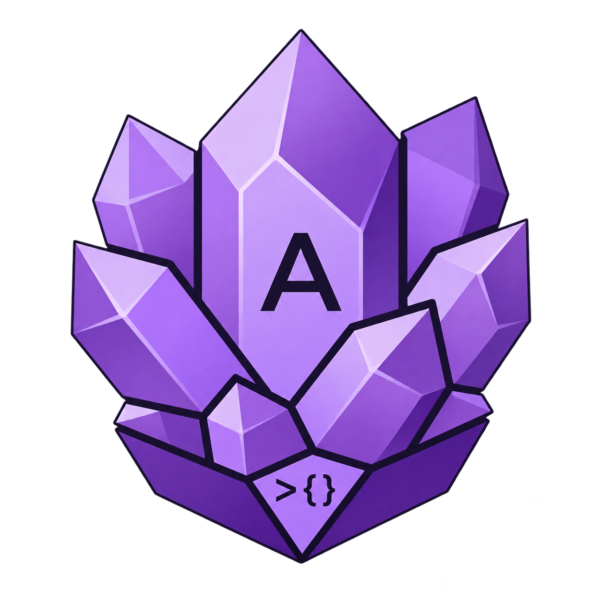
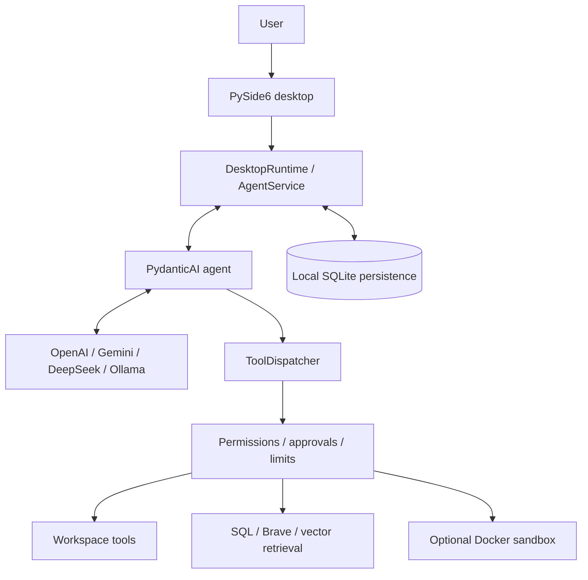

# Amethyst

<p align="center">
  
</p>

<p align="center">
  <strong>A permission-aware AI coding assistant for the desktop.</strong>
</p>

<p align="center">
  Built during <strong>1Hack</strong> · Python 3.13+ · PydanticAI · PySide6 · Local-first desktop
</p>

Amethyst is a hackathon project exploring what happens when an AI coding agent is treated as a **software system with boundaries**, not simply a language model with permission to do anything.

It combines a desktop chat interface, configurable AI models, developer-oriented tools, local conversation storage, and an explicit authorization layer. The goal is to help people inspect and modify code while **keeping file access, tool execution, and consequential changes under user control**.

> **Status:** Completed hackathon prototype. The integrated code is available on the default [`main` branch](https://github.com/IagoGran/1hack-Amethyst). The project includes automated tests, but it is **not presented as a production-ready or security-certified application**. Some integrations require external services; live-provider and supported-platform acceptance checks are still pending.

## The idea

AI agents are useful because they can select tools and perform multi-step tasks. They are also risky when model output is allowed to become an unrestricted action.

Amethyst investigates a different design:

1. A model interprets the user's programming task and selects from available tools.
2. Application services validate the requested action against the current configuration and permissions.
3. Protected actions require the user's explicit approval, including review of proposed file changes.
4. The interface shows task progress and tool outcomes, while conversation state is persisted locally.

The central engineering question is **how to combine agent autonomy with observable behavior and meaningful human control**.

## What was built

| Component | Functionality in the repository |
| --- | --- |
| **Desktop UI** | PySide6 interface with chat, model selection, saved conversations, connection configuration, skills, permissions, operational limits, task details, and resource monitoring. |
| **Agent orchestration** | PydanticAI-managed model/tool loop with configurable OpenAI, Gemini, DeepSeek, and local Ollama providers. |
| **Workspace tools** | Scoped file and directory reads, directory creation, and proposed text-file changes; protected operations require review and approval. |
| **External data tools** | Read-only queries to SQLite or PostgreSQL, Brave web search, and vector search adapters for Qdrant, Chroma, and Milvus. |
| **Controls and history** | Cancellation, token budgets, bounded results and timeouts, permission revocation, conversation persistence, action metadata, and reviewed undo for text edits. |
| **Sandbox implementation** | Optional Docker-based command execution with a read-only workspace mount and network access denied by default; **disabled unless explicitly configured after host validation**. |

The tools available to an agent depend on the selected model, configured connections, installed optional dependencies, permissions, and runtime configuration. An implemented adapter does not automatically imply verified compatibility with every live service.

## Architecture



The project separates responsibilities into **domain contracts, application services, ports, adapters, security, configuration, and user-interface modules**.

Three decisions are especially important:

- **Model decisions are not authorization.** Only registered structured tool calls are dispatched; ordinary model text is never interpreted as a command.
- **Changes are reviewed.** Workspace edits use proposals and diffs; approval is tied to the exact operation and relevant file state. Later undo also requires review.
- **Access is scoped.** A conversation uses a selected workspace root with a revocable read grant; external connectors and command execution follow their own permission boundaries.

For the detailed implementation, see [Architecture](docs/integration_architecture.md), [Desktop integration](docs/desktop_integration.md), [Tool inventory](docs/tool_inventory.md), and [Sandbox boundaries](docs/sandbox_runtime.md).

## Tech stack

| Area | Technologies |
| --- | --- |
| Language and environment | Python 3.13+, uv |
| Desktop | PySide6 / Qt |
| AI agents | PydanticAI |
| Model providers | OpenAI API, Gemini API, DeepSeek API, Ollama |
| Data and retrieval | SQLite, PostgreSQL, Brave Search, Qdrant, Chroma, Milvus |
| Local persistence | SQLite; OS credential store with an in-memory fallback |
| Restricted execution | Docker Engine / runc, approved workspace mounts |
| Quality tooling | pytest, Ruff, mypy |

PostgreSQL and vector-store clients are optional dependencies. A local Ollama model or an external model API must be configured before chatting.

## Run locally

### Requirements

- Python **3.13+** and [uv](https://docs.astral.sh/uv/).
- A desktop environment on **Ubuntu 24.04 LTS (x86-64)**, or **Windows 11 using Ubuntu/WSL2 with GUI support**.
- An available model provider: an API-backed model or a local Ollama server/model.

These are the project's target configurations; visible end-to-end platform acceptance remains incomplete. There is no native installer in this repository.

### 1. Clone the repository

```bash
git clone https://github.com/IagoGran/1hack-Amethyst.git
cd 1hack-Amethyst
```

The complete integrated code is already in `main`; no branch switch is needed.

### 2. Install the environment

```bash
uv sync --group dev
```

To install the optional database and vector-store clients together:

```bash
uv sync --group dev --extra integrations
```

Individual extras are also available: `postgresql`, `qdrant`, `chroma`, and `milvus`.

### 3. Launch the desktop

```bash
uv run 1hack-amethyst
```

Equivalent command:

```bash
uv run python -m amethyst
```

### 4. Configure a model and start a conversation

1. Open **Connections → Models** and create a model connection. Enter the provider, model identifier, and API key if required. For Ollama, configure a local model.
2. Choose the saved model in **Chat**.
3. Optionally configure a SQL, Brave, or vector-search connection under **Connections → Tools**.
4. When working with files, choose a workspace root for the conversation and explicitly authorize reads. Proposed changes must be approved separately.
5. Use **Task details**, **Permissions**, **Skills**, and **Operational limits** to inspect or control how the agent operates.

The application stores conversation history and settings locally. A remote model provider will still receive the data sent to it; "local-first" does **not** mean every model invocation runs offline.

### Optional sandbox

Sandboxed command execution is **off by default**. Its Docker profile requires a validated local host, a pre-provisioned image pinned by SHA-256 digest, explicit enablement, and approval for individual commands. The workspace is mounted read-only and network access is denied unless specifically authorized.

Do not enable it as a general-purpose security guarantee. Read [the sandbox runtime guide](docs/sandbox_runtime.md) before configuring it.

## Code structure

```text
src/amethyst/
├── adapters/       # Model, persistence, SQL, web, and vector adapters
├── application/    # Agent lifecycle, task state, and tool dispatch
├── configuration/  # Model/tool connection and runtime settings
├── domain/         # Shared task and event contracts
├── ports/          # Interfaces for the major subsystems
├── security/       # Permissions, approvals, workspace, Docker, credentials
├── skills/         # Skill selection
└── ui/             # PySide6 desktop interface

docs/                # Design, architecture, integration and security notes
tests/
├── unit/           # Deterministic unit tests
├── integration/    # Cross-component and opt-in live sandbox tests
└── support/        # Fixtures and test doubles
```

## Tests and current limitations

To run the project's checks:

```bash
uv run pytest
uv run ruff check .
uv run mypy src tests
```

The repository's [desktop integration report](docs/desktop_integration.md) records **152 passing deterministic tests**, **three skipped opt-in real-container tests**, **93.09% combined coverage**, and **85.99% branch coverage** at a validation checkpoint dated **14 November 2026**. These are **documented project results**, not a claim that tests were rerun as part of this README update.

Important boundaries of the completed hackathon prototype:

- **Live integrations:** unit and local-fixture tests do not prove that every model provider, search provider, database, or vector store works against its real service.
- **Docker:** the sandbox is implemented but disabled by default; live host/container acceptance is still pending.
- **Vector retrieval versus full RAG:** vector querying is implemented, but automatic natural-language embedding generation and a full ingestion pipeline are not verified features.
- **MCP:** the initial project description mentioned Model Context Protocol; the integrated source does **not** implement an MCP connector.
- **Desktop acceptance:** visible GUI validation, accessibility/performance benchmarks, and production packaging remain outside the verified scope.
- **Data protection:** local persistence is not equivalent to database encryption or a completed backup strategy.

The purpose is to document **what the prototype demonstrates**, without claiming the maturity of a released coding assistant.

## What we learned

Amethyst was built for **1Hack** as an exploration of agentic AI engineering. Beyond integrating language models, its technical challenge was coordinating several concerns that are easy to ignore in small demos: tool contracts, state, UI responsiveness, authorization, failure handling, persistence, and deterministic testing.

The project's main takeaway is that **the engineering surrounding an AI model can be just as important as the model itself**—especially when an agent can inspect a workspace or propose changes to someone's code.
